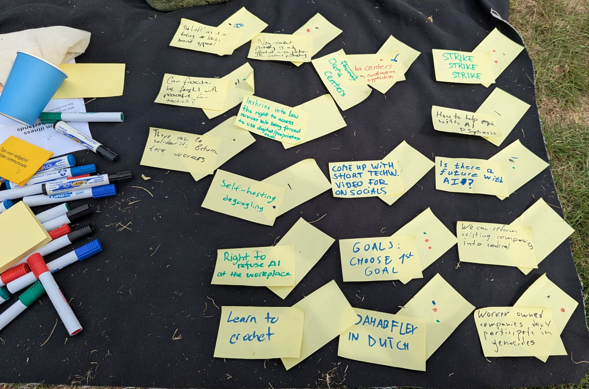

In het afgelopen augustus kwamen techwerkers bij elkaar om gezellig te kletsen en van lekker eten te genieten.

Zoals bij de meeste evenementen van Techwerkers was het vooraf lastig in te schatten hoeveel mensen er zouden komen. Zelfs met slechts 4 of 5 personen was het al leuk geweest, maar op het hoogtepunt waren we met wel 19 mensen (wat het natuurlijk nóg leuker maakte!). Een kleine aanmoediging voor toekomstige evenementen: als je twijfelt of je wel iemand kent - weet dan dat je zeker niet de enige bent!

We spraken af bij [Jagerplas](https://www.openstreetmap.org/relation/1160025), een natuurgebied ten noordoosten van Zaandam en ten noordwesten van Amsterdam. Het weer was heerlijk: af en toe een blauwe lucht, maar zonder de brandende hitte. De eersten arriveerden rond 11:30 uur en zetten een tent op, zodat we lekker in de schaduw konden zitten. Er was muziek, eten en drinken om met elkaar te delen.

Rond 14:00 uur organiseerden we een informele 'unconference' voor de liefhebbers. Voor wie niet bekend is met het concept: een unconference is een spontane bijeenkomst waarbij deelnemers onderwerpen aandragen. Vervolgens stemmen we op de thema's die we willen bespreken, splitsen we op in gespreksgroepen van een half uur, en komen we daarna weer samen om de belangrijkste punten uit de gesprekken te delen. We zullen de details van die gesprekken niet prijsgeven, maar hier is een foto van wat er zoal in de hoofden van de aanwezigen speelde:

{data-medium-zoom="1"}

Zie je iets staan dat jou ook wilt over spreken? Wil je hierover met anderen in gesprek gaan en aan de gang gaan? [Word vandaag lid van Techwerkers.](https://techwerkers.nl/nl/join/)

Wil je wel eens uithangen met andere tech-nerds? Vind je meer op onze [evenementenpagina](https://events.techwerkers.nl).
