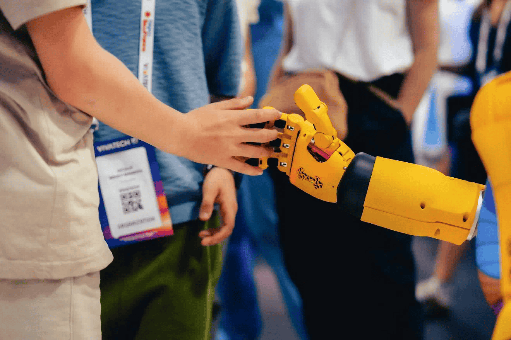
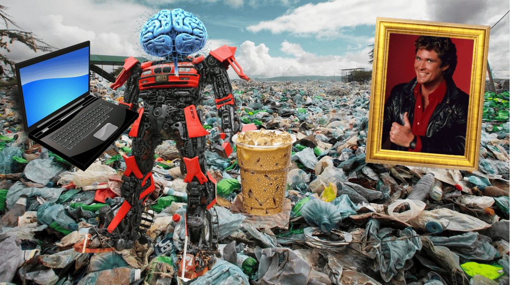
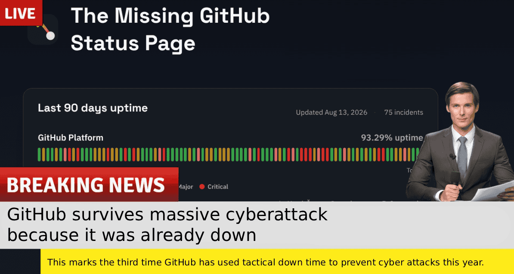

## Nieuwe artikelen

### Een manifest voor verantwoord agentisch programmeren

Moet je generatieve AI boycotten? Maar wat als je opgehypete baas je onder druk zet? Geen zorgen, er is een middenweg. Een techwerker deelt diens manifest voor verantwoord agentisch programmeren.

[Lees het manifest.](https://www.techwerkers.nl/nl/posts/manifesto-responsible-agentic-coding/)

### Dus je bent 10x zo productief met AI. Maar hoe zit het met je loon?

Sommige werkers zeggen 10x zo productief te zijn met AI. Maar krijgen ze ook 10x zoveel loon? Een techwerker geeft wat suggesties om nog meer uitbuiting te voorkomen.

[Bekijk het advies.](https://www.techwerkers.nl/nl/posts/ai-productivity-wages/)

## Agenda

Wil je andere techwerkers ontmoeten? Sluit je aan bij een van de komende evenementen:

- 7 sep, 19:00-20:00 uur - [SWOT-analyse (Techwerkers)](https://events.techwerkers.nl/event/swot-analysis-techwerkers), online
- 9 sep, 0:00 - 23:59 uur - [Openbaar vervoerstaking](https://events.techwerkers.nl/event/staking-openbaar-vervoer-or-public-transport-strike), Nederland
- 11 sep, 15.00-15.30 uur - [Vrijdag koffieleuten](https://events.techwerkers.nl/event/friday-fika-or-vrijdagsfika-1), online
- 12 sep, 12:30-16:30 uur - [Techwerkersblok @ Klimaatmars 2026](https://events.techwerkers.nl/event/techwerkersblok-klimaatmars-2026), Amsterdam
- 14 sep, 19:00-20:00 uur - [Organisatiebijeenkomst](https://events.techwerkers.nl/event/organizing-meetup-or-organisatiebijeenkomst-16), online
- 15 sep, 19:30-20:30 uur - [Brainstormsessie AI-regelgeving](https://events.techwerkers.nl/event/ai-regulation-worker-brainstorm), online: https://meet.jit.si/TechwerkersAIBrainstorm
- 16 sep, 19:30-20:30 uur - [Na het ontslag: Herstel je zelfvertrouwen, welzijn en carrière](https://events.techwerkers.nl/event/beyond-the-layoff-rebuild-your-confidence-wellbeing-and-career), online (registratie vereist)
- 17 sep, 00:00-01:00 uur - [Brainstormsessie: Ethische gedragsrichtlijnen voor techwerkers](https://events.techwerkers.nl/event/brainstorm-tech-worker-code-of-ethics), online (registratie vereist)
- 17 sep, 19.00-22.00 uur - [Leiden Software Meetup](https://events.techwerkers.nl/event/leiden-software-meetup-1), Café De Keyzer, Leiden
- 18 sep, 15.00-15.30 uur - [Vrijdag koffie leuten](https://events.techwerkers.nl/event/friday-fika-or-vrijdagsfika-26), online
- 19 sep, 13.00-16.00 uur - [Bijeenkomst Schrijfmaand Vakbonden en Arbeidersgeschiedenis op Wikipedia](https://events.techwerkers.nl/event/bijeenkomst-schrijfmaand-vakbonden-en-arbeidersgeschiedenis-op-wikipedia), Wikimedia Nederland kantoor, Utrecht
- 19 sep, 19.30-22.30 uur - [Techwerkers rennen Damloop by Night](https://events.techwerkers.nl/event/techwerkers-rennen-damloop-by-night), Zaandam
- 24 sep, 19.30-20.30 uur - [Vrij Socialisme, een inleiding op de Federatie voor Vrij Socialisme (FVS)](https://events.techwerkers.nl/event/vrij-socialisme-101-or-free-socialism-101), online: https://meet.jit.si/VrijSocialisme101
- 25 sep, 15.00-15.30 uur - [Vrijdag koffieleuten](https://events.techwerkers.nl/event/friday-fika-or-vrijdagsfika-27), online
- 28 sep, 19.00-20.00 uur - [Organisatiebijeenkomst](https://events.techwerkers.nl/event/organizing-meetup-or-organisatiebijeenkomst-17), online
- 4 okt, 9:00-12:00 uur, [Techwerkers rennen Singelloop](https://events.techwerkers.nl/event/techwerkers-rennen-singelloop), Utrecht

Voeg ook zelf gerust interessante evenementen toe [aan de kalender](https://events.techwerkers.nl/).

<figcaption style="text-align: center;"><i>Tactische onbereikbaarheid om cyberaanvallen te voorkomen. Eindelijk 100% veilig.</i></figcaption>

## Op de radar

Enkele nieuwsberichten die deze maand de aandacht van techwerkers trokken:

- “Alles is duur tegenwoordig”. [Werkers in de schoonmaaksector staken](https://www.youtube.com/watch?v=rbNOuQAZyS0) voor beter loon.
- [Havenwerkers in Rotterdamse staakten op 4 september hun werk](https://www.joc.com/article/port-strikes-hit-europe-as-schedule-reliability-drops-to-single-digits-6281165) om de Nederlandse overheid onder druk te zetten een voorstel tot bezuinigingen op de sociale zekerheid en pensioenen in te trekken.
- Uber-werkers in Nederland, samen met collega's uit België, Frankrijk, Duitsland, Polen, Roemenië en het Verenigd Koninkrijk, [hebben een collectieve rechtszaak aangespannen tegen het bedrijf](https://www.taxi-point.co.uk/post/uber-faces-collective-action-over-dynamic-pay-as-uk-drivers-claim-5-300-annual-income-reduction). De werkers eisen een schadevergoeding voor gederfde inkomsten (gemiddeld € 7.500 per jaar) en schendingen van de wetgeving inzake gegevensbescherming vanwege het vermeende manipulatieve algoritme van Uber voor het vaststellen van de lonen.
- [Werkers van het contactcentrumbedrijf Transcom wijzen een voorstel voor voorwaarden bij massaontslag af.](https://uniglobalunion.org/news/transcoms-to-exit-netherlands-workers-jobs/) Transcom wil ongeveer 150 werkers ontslaan en na 26 jaar diens vestiging in Nederland sluiten, om daarna elders weer uit te breiden.
- Werkers van Airbus [staken voor mogelijkheden tot thuiswerken en winnen](https://www.theguardian.com/business/2026/aug/21/airbus-bows-remote-working-strikes).
- Blijkt trouwens dat volledig thuiswerkende mensen het hoogste welzijn ervaren en minder snel ontslag nemen dan deels thuiswerkende of volledig op kantoor werkende mensen, zo [toonde een onderzoek onder meer dan 7000 zorgwerkers aan](https://doi.org/10.3389/fpsyg.2026.1848857).
- Anna's Archive roept mensen op om boeken te scannen en te uploaden, [om te voorkomen dat AI-bedrijven fysieke exemplaren vernietigen](https://www.tomshardware.com/tech-industry/artificial-intelligence/worlds-largest-open-library-calls-for-volunteers-to-scan-and-preserve-physical-books-as-ai-companies-buy-scan-and-destroy-them-annas-archive-says-time-is-running-out-as-knowledge-is-permanently-monopolized-on-private-servers) om de hongerige LLM-monsters te voeden.
- Google Search sterft uit. [De AI-samenvattingen die het vervangen zijn nog erger.](https://thewalrus.ca/google-search-is-dying/)
- Een kort antwoord van een mens is meer waard dan een lap tekst van een bot, zelfs als die bot gelijk heeft. [Dus plak die AI-gegenereerde tekst niet.](https://dontpastetheai.com/) Echt niet. [Stop met het sturen van AI-gegenereerde tekst.](https://dontpastetheai.com/angry/)
- Veiligheidswerkers aan de wereld: “Je kunt leeftijds- of identiteitsverificatie niet veilig uitvoeren. Het creëert altijd een soort registratie en die registraties zullen altijd een doelwit worden.” Dit nadat [de zogenaamd ‘veilige’ bedrijf IDScan meer dan een jaar lang een stroom van zo ongeveer 153 miljoen identiteitsdocumenten aan hackers bleek te hebben gelekt](https://www.techdirt.com/2026/09/03/hackers-had-a-live-feed-of-every-id-this-verification-company-scanned-for-over-a-year/).
- Twitter eh sorry [X heeft een sommatiebrief gestuurd naar Nitter en XCancel](https://www.tweaktown.com/news/113272/xcancel-and-nitter-receive-cease-and-desist-letters-from-x-over-alleged-scraping/index.html), waar waarmee je de registratiemuur van X kunt omzeilen. Einde van een tijdperk? [Niet zo snel.](https://github.com/zedeus/nitter/commit/1428b4c2b4246f92a7e5b2673438e5fb39fcc4a3)
- Het Noorse _Forbrukerrådet_ (Consumentenbond) beschrijft [een dag uit het leven van een _ensh\*ttificator_](https://www.youtube.com/watch?v=T4Upf_B9RLQ) (_ensh\*ttifier_? verkloter).
- [LOW←TECH MAGAZINE](https://solar.lowtechmagazine.com/power/) is een website die draait op zonne-energie. Slecht weer? Dan is de site offline.

<figcaption style="text-align: center;"><i>Je computer praat misschien niet altijd terug. Maar als-ie schreeuwt kun je maar beter luisteren.</i></figcaption>
