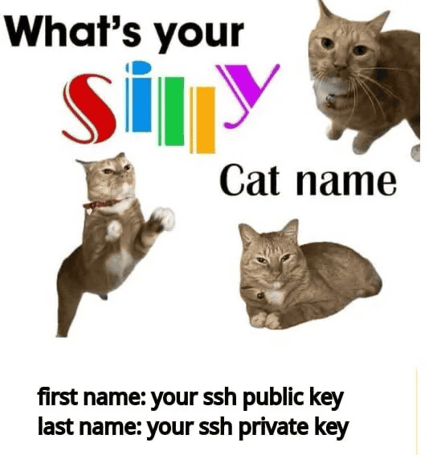
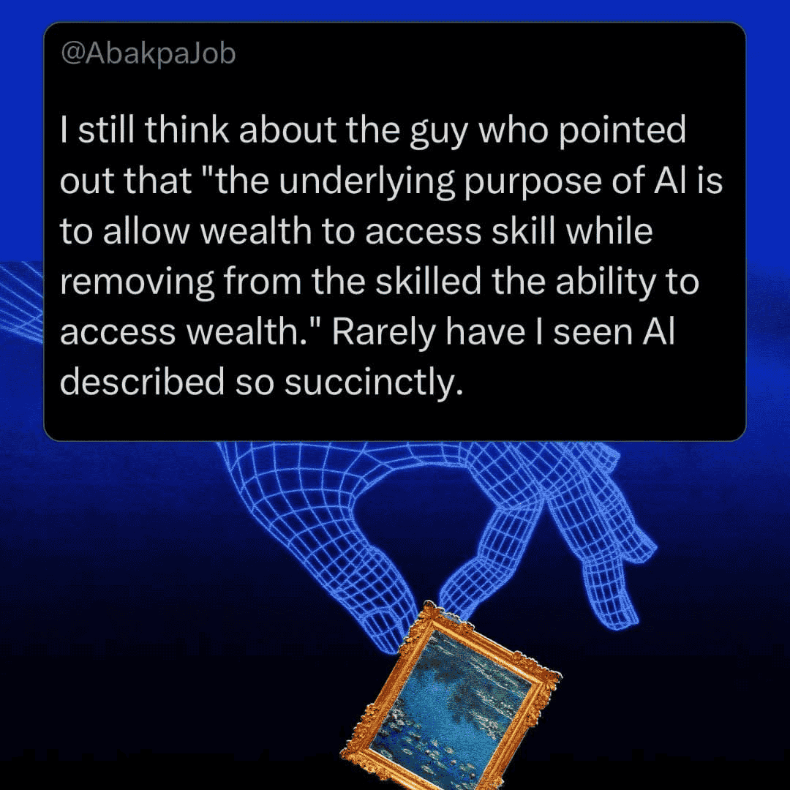

What's happening? [Through a](https://nltimes.nl/2026/09/09/thousands-quit-working-part-public-transport-strike-politicians-visit-strikers) [series](https://www.globalbankingandfinance.com/dutch-public-transport-halted-strike-against-welfare-cuts/) [of](https://nltimes.nl/2026/09/07/heineken-staff-join-nationwide-social-security-protests-3-hour-work-stoppage-monday) [strikes](https://www.epsu.org/article/public-service-workers-mobilise-against-social-security-cuts-hague), workers in the Netherlands have succeeded this month in pushing the government to [U-turn on its proposed social security cuts](https://uniglobalunion.org/news/dutch-labour-movement-forces-government-u-turn-on-e6-billion-welfare-cuts/). FNV union boss Hans Spekman has written to members to proclaim victory. But is it really?

While social security provisions may (temporarily) be spared, the government now proposes to slash €1.2 billion from the education budget to finance its delirious military spending. Who needs education anyway, when workers are just expected to die at the front lines?

In all seriousness: if workers suffer while bosses, bureaucrats, and billionaires stay put, that’s no time to get the bubbly out. By announcing that FNV union no longer expects it members to proceed with planned industrial actions, Spekman is ruling out that workers will use one of the most powerful tools they have available to them to resist exploitation and oppression, namely, their labour power. Luckily, workers don’t need to let their actions be dictated by what bosses say.

Not even if they’re union bosses.

That’s why, this month, you’ll find several updates on worker resistance against militarism. Plus, ways in which _you_ can get involved.

_Moedig voorwaarts_

## Announcement

### Missing you? 🥹

Have you been keeping a low profile recently? If you were previously part of the Techwerkers Discord server, you may have noticed it’s been retired (bye bye big tech). In its place: a shiny new self-hosted [community platform](https://community.techwerkers.nl). Friendly, collaborative, and completely yours. Dip into initiatives, tech memes, or share some good ol’ banter in one of the voice rooms. Come and say hi! If you need a fresh invite, reply to this message or ping `@admin` on the old Discord.

### Amsterdam regular tech worker meetup

Would you enjoy a regular (monthly-ish) social meetup with fellow tech workers in or around Amsterdam? It might be an option soon! Fill out the poll to indicate which day(s) of the week could work for you: [Techwerkers Meetup Availability - When2meet](https://www.when2meet.com/?38877386-1Z4XI) (nickname is fine)

Looking forward to hanging out :)

<figcaption style="text-align: center;"><i>Don’t reveal your silly cat name</i></figcaption>

## Volunteer

The tech worker community in the Netherlands is growing, and _you_ can help build its foundations. Here’s are some open roles in which you can get involved.

### Community building 🌱

Must… combat… individualism… As community builder you’ll be part of a growing team of workers who help fellow workers connect with one another. You’ll make people feel welcome, and develop new ideas and initatives to strengthen Techwerkers. Because community is strength, and it can be a lot of fun.

### Book club coordinator 📚

Book club is looking for a new coordinator! Do you enjoy reading, or listening to audio books? Keen to talk about ideas with others? Then organising the book club might be something for you. Fun fact: many current tech worker initiatives were initially born in the book club, so you’ll be at the source of a healthy dose of tech worker buzz.

### Worker research 🕵️

Knowledge is power, so workers can use it to win. Are you interested in stats, facts, free information, analysis, getting a clearer view on things? Then join the research team. You don’t need to have experience. Just bring your curiosity, stamina, and a desire to get to the true picture. Experienced researchers are here to support you.

### Do you have workplace organizing experience? ✊

Do you want to help workers team up with their co-workers, build power, fight the boss, and unionize? Techwerkers needs _you_! Every month workers reach out because they’re fed up with the status quo. Are you an organizer who can coach them as they build relationships, organizing committees, and campaigns? Or are you interested in becoming one? Get in touch.

Interested? Reply to this email, or message `@Kit` on the [community platform](https://community.techwerkers.nl) by **31 October**.

_All Techwerkers roles are 100% volunteer-based. Everyone is donating their own time and energy to build worker power together._

<figcaption style="text-align: center;"><i>Keep on lickin’ (pic: anonymous worker)</i></figcaption>

## Upcoming events

Learn, get active, chill. Here’s some events on the tech worker radar this month. Got a tip? [Suggest an event](https://events.techwerkers.nl/).

### Tech workers run Singelloop

Sunday 4 October, 9:00 am-12:00 noon, Binnenstad, Utrecht ([info](https://events.techwerkers.nl/event/techwerkers-rennen-singelloop))

Tech workers run the Singelloop! Come cheer them on at the start at the Croeselaan, or at the finish at the Catharijnesingel in Utrecht.

### Fair tech summit Europe

Tuesday 6 October, Mama Shelter Luxembourg ([info](https://events.techwerkers.nl/event/fair-tech-summit-europe))

A one-day European conference for those who no longer simply observe digital dependencies and unethical technologies, but are actively building the technologies Europe needs. Ethical tech makers, privacy advocates, open-source contributors, sustainability transformers, entrepreneurs, institutions, investors and civil society together.

### Coffee chat

Online, [Techwerkers Just chatting space](https://zep.us/play/Ov31J5)

- Friday 9 October, 3:00-3:30 pm ([info](https://events.techwerkers.nl/event/friday-fika-or-vrijdagsfika-29))
- Friday 16 October, 3:00-3:30 pm ([info](https://events.techwerkers.nl/event/friday-fika-or-vrijdagsfika-30))
- Friday 23 October, 3:00-3:30 pm ([info](https://events.techwerkers.nl/event/friday-fika-or-vrijdagsfika-31))
- Friday 30 October, 3:00-3:30 pm ([info](https://events.techwerkers.nl/event/friday-fika-or-vrijdagsfika-32))

Pop in for a casual, pre-weekend coffee chat with other tech workers, feel free to jump in & out whenever suits. Bring your own hot drink + pastry!

### Modern Warfare: Understanding & Strategically Boycotting Militarism in Games

Saturday 10 October, 7:00-9:00 pm, [online](https://events.techwerkers.nl/place/1/online) ([info](https://events.techwerkers.nl/event/modern-warfare-understanding-and-strategically-boycotting-militarism-in-games-online-workshop))

In this interactive online session, we’re going to explore how the video games industry is deeply entwined with the imperialist war machine, and how, through No Games for Genocide’s Boycott Xbox Campaign, we can build a movement to strategically boycott and divest from militarism in games.

### Unions and the far right – experiences from Germany

Monday 12 October, 3:00-4:30 pm, De Burcht, Amsterdam ([info](https://events.techwerkers.nl/event/vakbonden-en-extreemrechts-ervaringen-uit-duitsland))

What’s the relation between the far right and the trade union movement? A discussion with Jan Rottenbach, who works for the trade union IG Metall on the 'Verein zur Bewahrung der Demokratie' campaign.

Presentation in German, with Dutch translation.

### Organizing meetup

Online (Community platform, Meetup channel)

- Monday 12 October, 7:00-8:00 pm ([info](https://events.techwerkers.nl/event/organizing-meetup-or-organisatiebijeenkomst-18))
- Monday 26 October, 7:00-8:00 pm ([info](https://events.techwerkers.nl/event/organizing-meetup-or-organisatiebijeenkomst-19))

Get together with other tech workers to plan actions, events, and organize next steps.

### AI regulation working group

Tuesday 13 October, 7:30-8:30 pm, Online (Community platform, Meetup channel) ([info](https://events.techwerkers.nl/event/ai-regulation-working-group-or-ai-regulering-werkgroep-1))

Meetup of the AI regulation working group, to create a guide for policy makers, unions, and works councils, mainly focused on job security and labour rights.

### Digital Investigations for workers' power

Wednesday 14 October, 6:00-8:00 pm, [online](https://meet.jit.si/reversegaze) ([info](https://events.techwerkers.nl/event/digital-investigations-for-workers-power-or-digitaal-onderzoek-voor-macht-aan-de-werkers))

[Reversing.works](http://Reversing.works) invites you to discover how technical investigations of mobile and web apps can help workers build power, avoid employer's surveillance, and fight back against abuses. ​They will present their methodology together with their brand new handbook in which they document their practices.

### Leiden Software Meetup

Thursday 15 October, 7:00-10:00 pm, Café De Keyzer ([info](https://events.techwerkers.nl/event/leiden-software-meetup-2))

Join Leiden Software Meetup for monthly social drinks.

### Rise up against data centres | Kom in opstand tegen datacentra

Friday 6 November, Amsterdam ([info](https://events.techwerkers.nl/event/rise-up-against-data-centres-or-kom-in-opstand-tegen-datacentra))

Data centres are causing pollution, depleting water resources, and slurping energy that's no longer available to workers and others in society. The group _Geef Tegengas_ is organizing an action against data centres. Some tech workers are planning to attend as well, and you're invited to join! Details to be confirmed.

<figcaption style="text-align: center;"><i>Keep your skills, grab back wealth</i></figcaption>

## World of (tech) work

Union action, AI distraction, and a thousand blooming servers. Here’s what to keep an eye on this month.

### [Public transport unions threaten weekly strikes until Christmas](https://nltimes.nl/2026/10/01/public-transport-unions-threaten-weekly-strikes-christmas) (NL Times)

Workers associated with the trade unions FNV and CNV are preparing to hold weekly strikes in regional public transport from 12 October onward, if bosses don’t meet their demands. According to an FNV spokesperson, bosses are still pushing a broad package of measures that would worsen workers’ conditions. Workers demand a new collective labour agreement that includes a 6% wage increase, reduces the workload, and includes an fair arrangement for older workers.

### [The EFJ supports the Dutch class action lawsuit against Meta](https://europeanjournalists.org/blog/2026/09/29/the-efj-supports-the-dutch-class-action-lawsuit-against-meta/) (European Journalists)

The Nederlandse Vereniging van Journalisten (NVJ), Lira Foundation and the Auteursbond (authors’ union) are preparing a collective lawsuit against Meta. They allege that Meta is using the work of freelance journalists, writers, and translators to train its AI models, without consent and without pay. The organizations want a collective agreement with AI companies that ensures fair pay, gives creators control over their texts. and makes tech companies transparent about how they use people’s creative work.

### [The rise of unionisation in games workplaces](https://www.gamesindustry.biz/state-of-the-unions-the-rise-of-unionisation-in-games-workplaces) (Games Industry)

More and more workplaces in the games industry are unionizing. Austin Kelmore, co-founder of the IWGB Game Workers and Game Worker Solidarity, said: "As unions become larger and workers have built more power, we've been able to apply pressure to those at the top and improve things in two ways: advocate and push for the things we want and stop harmful treatment from those who employ us.”

### [Amsterdam protest says no to war and conscription](https://www.counterfire.org/article/amsterdam-protest-says-no-to-war-and-conscription/) (Counterfire)

Several tech workers took part in the biggest Dutch anti-war demonstration in years, on 27 September in Amsterdam. Fellow tech worker Mark wrote a report of the events leading up to the protest and the day itself.

### [Freek Thomassen has died](https://vakbondshistorie.nl/dossiers/freek-thomasson-1-juli-1944-2-september-2026/) (Vakbondshistorie)

<figcaption style="text-align: center;"><i>Freek Thomasson, pic by Coen Borgsteede</i></figcaption>

Worker and trade unionist [Freek Thomassen (1944–2026) has died](https://vakbondshistorie.nl/dossiers/freek-thomasson-1-juli-1944-2-september-2026/). Thomassen was active with organizations including the International Confederation of Free Trade Unions (ICFTU) and the United Nations' International Labour Organization (ILO). Thomassen also published their [memoirs, _Principes Boven Eigenbelang_](https://vakbondshistorie.nl/dossiers/freek-thomasson-memoires/).

### [Trade Union Congress supports Palestine](https://novaramedia.com/2026/09/16/uk-trade-unions-back-palestinian-led-bds-movement-in-historic-vote/) (Novara Media)

Workers at the Trade Union Congress (TUC), an annual gathering of the UK’s major unions in Brighton, representing over 5.3 million people, has endorsed the movement for boycotts, divestment and sanctions (BDS) against entities occupying Palestine. The vote commits the TUC, and its member unions, among other things, to:

- actively campaign for the UK to end [military cooperation](https://novaramedia.com/2026/09/03/burnhams-government-has-approved-10-military-flights-to-israel-in-6-weeks/) with Israel
- support the introduction of broader sanctions against Israel
- support trade unionists who refuse to handle goods and services linked to violations of international law

When will Dutch unions finally take a stand?

### [AI Workers' Inquiry 2026](https://techworkersinquiry.org/ai/) (United Tech and Allied Workers)

The United Tech and Allied Workers (UTAW) union in the UK has published a workers' inquiry on AI. The inquiry outlines how generative AI is changing work across the tech sector, written with the perspectives and experiences of workers who build, deploy, manage, evaluate and use this technology. Relevant for your workplace, potentially: a list of recommendations for workplaces and policy change.

### [The AGI Inquisition](https://monroelab.com/2026/09/09/the-agi-inquisition/) (Computational Impacts)

Since OpenAI released its model GPT-6 Astra, there’s been a notable increase in seemingly coordinated rhetorical attacks on scientists critical of AI, many of whom are women. Tech worker Dwayne Monroe comments: “Hard limits \[for the AI industry\] are in view and true believers, with no vision for the future beyond whatever they think ‘AI’ or ‘AGI’ are (usually whatever they’re told by the corporates), dimly aware of these limits but unable to accept what it means, are lashing out.”

### [Clamour about ‘AI existential risk’ is a distraction](https://www.youtube.com/watch?v=pauBYSQ1K_c) (Adam Conover)

Many AI bros now claim that their products are so risky, they might wipe out humanity. Adam Conover isn’t having it. The existential risk story is a distraction:

> “… by focusing on this largely hypothetical existential threat, \[AI companies\] are able to ignore all the bad things that they are currently doing right now. They're able to ignore the fact that the data centers they're building are using so much energy, they're basically reversing a generation's worth of progress on climate change, which is a real threat that is currently killing people around the world. They're ignoring the fact that their product is currently being used by bosses to fire employees in order to put in place an AI system that demonstrably cannot do their jobs yet. And they're able to ignore the fact that their technology is currently being used to kill civilians in Gaza. That is not science fiction. That is a threat right now.“

Never trust a billionaire on social issues.

### [Artificial intelligence data ‘land grab’ looms amid proposed digital changes](https://www.irishtimes.com/business/2026/09/21/ai-data-land-grab-looms-amid-proposed-digital-changes/) (The Irish Times)

GDPR sounded nice. Until the European Union (EU) realized it could also just … make worker data available to LLM providers! A leaked document shows that the EU Council wants to consider the use of personal data ‘in the context of AI’ as automatically lawful. Privacy activist Max Schrems: “Under these proposals, the profits of AI companies would trump \[Europeans’\] fundamental right to privacy. This is nothing short of the ‘digital expropriation’ of Europeans.”

### [Autistici/Inventati shuts down - Stay human](https://keepitfree.ai/announcements/a/i-shuts-down-stay-human/) (Keep the Internet free)

Autistici/Inventati (A/I) is shutting down. On 26 August A/I was notified that the US government placed this small Italian technology collective [on a sanctions list](https://keepitfree.ai/announcements/statement-by-a/i-collective-about-us-sanctions/). On 6 September the group announced that it would soon discontinue all of its services, as it would no longer be able to offer its users secure and non-commercial digital tools. Yet that’s not the end. The collective encourages others to [continue its mission](https://keepitfree.ai/announcements/go-forth-and-multiply-may-10-100-1000-servers-spark-up/): “May a thousand platforms bloom, may a thousand hacktivist collectives be born, may a thousand servers spark up! May the end of A/I produce a myriad infrastructures of dissent as we could never imagine before.”

<figcaption style="text-align: center;"><i>Battle of the model numbers</i></figcaption>

## Resources

Scoring systems, slop cover-ups, and the wonderful world of bootlicking. Here’s what tech workers are recommending this month.

### Book: [_The Score: How to Stop Playing Somebody Else's Game_](https://www.penguinrandomhouse.com/authors/2288505/c-thi-nguyen/)

Scoring systems encourage you to outsource your values to an external authority. They feast on simple, countable things. But do metrics capture what really matters, or just what’s easy to measure? _The Score_ by C. Thi Nguyen asks: Is this metrics-chasing game really the one you want to be playing?

### Video: _Against Tech Oligarchy: Worker Resistance in the World’s Most Powerful Industry_

As tech bosses cosy up to the right, tech workers fight back. In this video Clarissa Redwine and JS Tan discuss the tech worker movement that has challenged employers in the current decade, and analyze the increasingly hostile labour politics in Silicon Valley today.



### Sticker: Cover up slop

A [new sticker drop](https://drive.google.com/file/d/1oK-_tQERew5OJ6oS4UfSw9jdRwPyH0rI/view) by artist [Tomasz Spell](https://www.instagram.com/tom_spell/?hl=en), translated by a tech worker from the Polish. Do you see poster generated by AI? Stick it on and show them what you think! Or [get the Signal sticker pack](https://signal.art/addstickers#pack_id=3169049dcde96486374162ba1a121169&pack_key=74fe15003422742bc9828f7c0bf5ab9b68f0852a2c4e30f0f0dfe94eb80e9f25).

### Music: Likken aan de Laars, IJSLAND



_de laars van de baas, de aars van de baas_  
_je lijkt bijna trots op je plaats_  
_met je knieën op de straat_  
_totdat je die laars bling-bling hеbt gemaakt_

the boss's boot, the boss's arse  
you nigh look proud of your beat  
with your knees on the street  
‘til you've made that boot go _bling-bling_  
